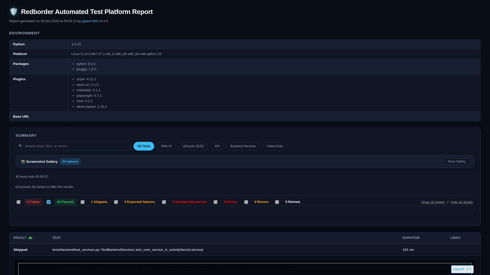
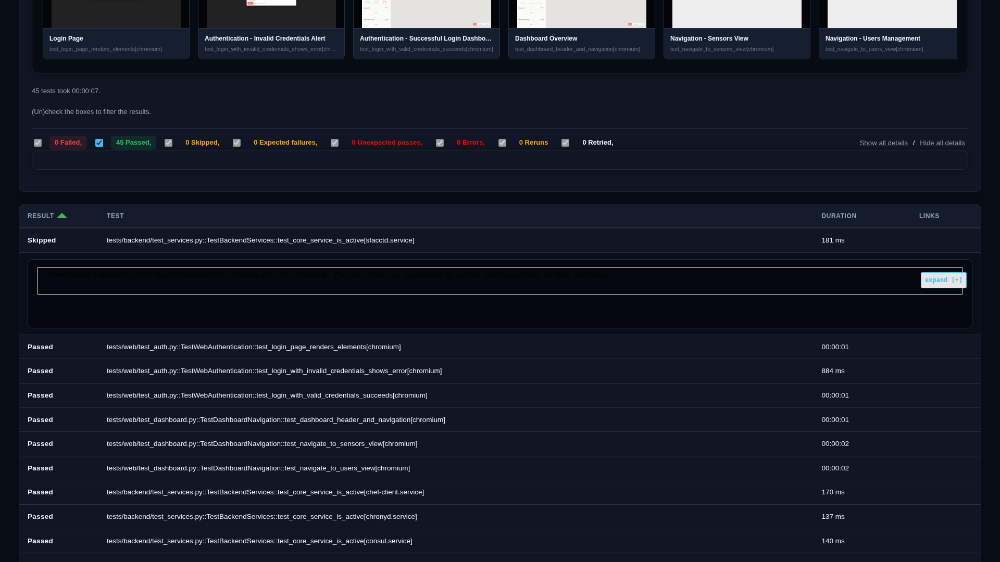
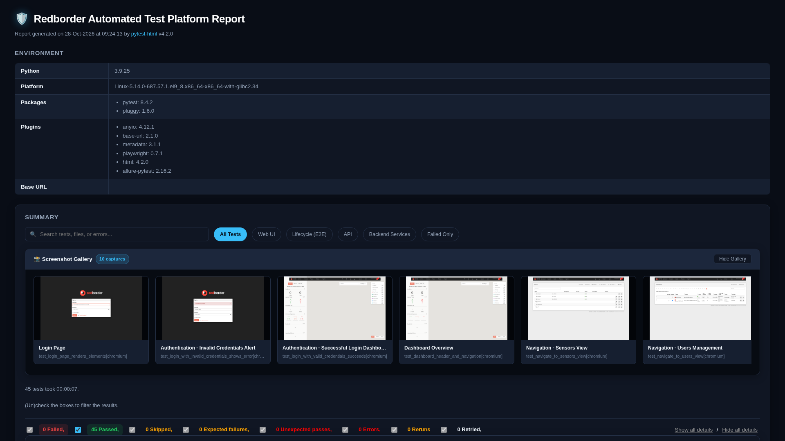
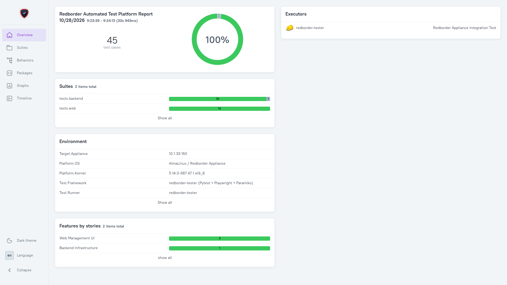
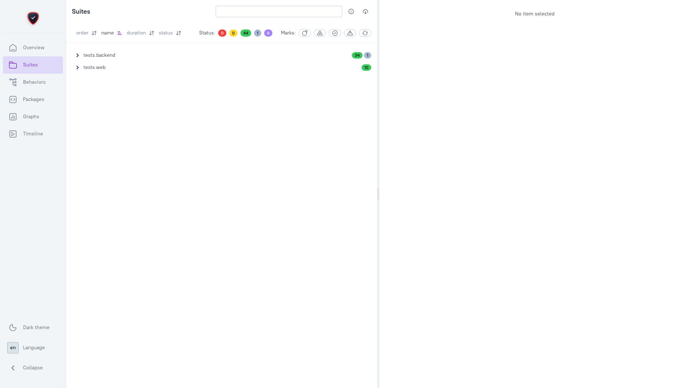

# Redborder Automated Test Platform (`redborder-tester`)

Enterprise automated testing suite for **Redborder Appliance**, covering Backend Infrastructure, REST APIs, Web Management UI, and full-lifecycle Sensor telemetry verification.

---

## 🌟 Key Features

- **Multi-Layer Test Coverage**:
  - **Backend Infrastructure**: Paramiko SSH verification of systemd units, Postgres, Druid, and Chef recipes.
  - **REST API Endpoints**: Session authentication, CSRF tokens, and JSON health endpoints.
  - **Web Management UI**: Playwright end-to-end browser automation for domain hierarchy navigation, CRUD operations, and sensor tree manipulation.
  - **All Sensor Types**: Flow, Vault (Syslog), SNMP, VMware ESXi, HTTP Agent, and SNMP Trap lifecycles.
  - **Drag & Drop Re-parenting**: Drag-and-drop sensor movement across domain hierarchies (`Service Provider`, `Namespace`, `Organization`) and to the root drop zone.
- **Enterprise Reporting**:
  - **Interactive Dark-Theme HTML Report** (`reports/report.html`) with dynamic search filtering and interactive Screenshot Gallery with Lightbox zoom.
  - **Executive Corporate PDF** (`reports/report.pdf`) with KPI cards, pass/fail ratios, and high-resolution visual evidence annex.
  - **Allure 2 Dashboard** (`reports/allure-report/`) with custom Redborder branding, Epics, Features, and timeline drill-downs.
- **Incremental Test Updates (`--update`)**:
  - Re-run any individual test or failed scenario and overwrite its result in the master report without wiping the rest of the test suite!

---

## 📸 Visual Showcase & Test Reports

`redborder-tester` produces rich, enterprise-grade test reports and visual diagnostics designed for engineers, QA teams, and executives:

### 1. Interactive Dark-Theme HTML Report (`reports/report.html`)
- **Dynamic Search & Module Filtering**: Filter tests instantly by domain (`Web UI`, `Lifecycle (E2E)`, `API`, `Backend Services`, `Failed Only`).
- **Detailed Step Logs & Visual Evidence**: Collapsible test rows containing console logs, stack traces, and captured browser screenshots.
- **Visual Screenshot Gallery & Lightbox**: Quick-access carousel ribbon displaying all screenshots captured during test runs with modal zoom.


*Figure 1: Interactive Dark-Theme HTML test execution report with module filtering and KPI counters.*


*Figure 2: Test breakdown with detailed execution logs, stack traces, and captured appliance screenshots.*


*Figure 3: Built-in visual evidence gallery ribbon with full-screen lightbox zoom.*

---

### 2. Allure Executive Dashboard (`reports/allure-report/`)
- **Executive KPI Portal**: Automated triage categories (*Product Defects*, *Infrastructure & Systemd Failures*, *UI & DOM Regressions*, *Telemetry & Ingestion Timeouts*).
- **Suites Tree & Timeline Breakdown**: Complete hierarchy view across Epics, Features, and test steps with appliance environment metadata.


*Figure 4: Redborder-branded Allure executive dashboard with failure categorization and telemetry trends.*


*Figure 5: Detailed test hierarchy, setup/teardown steps, and execution timeline.*

---

## 📋 Prerequisites & Installation

### 1. Requirements

#### Test Runner (Client Machine)
- Linux OS (tested on AlmaLinux / Fedora / Ubuntu / Debian)
- Python 3.9+ with [`uv`](https://github.com/astral-sh/uv) (recommended) or `pip`
- **Allure CLI** *(Optional — only needed if compiling the Allure web dashboard)*:
  ```bash
  # Requires Java JRE and Node.js:
  sudo apt install -y default-jre nodejs npm
  sudo npm install -g allure-commandline
  ```
  *(Note: The primary HTML report `reports/report.html` works out of the box without Allure or any external dependencies).*

#### Target Appliance
- **`redborder-sensors`** package (`dnf install -y redborder-sensors`):
  - Required on the target appliance to manage sandboxed mock sensors via `/usr/libexec/redborder-sensors/sensor-ctl.sh`.
  - Generates realistic telemetry across Flow, Vault Syslog, SNMP, and HTTP Agent/Webserver test scenarios.
  - The test framework (`require_redborder_sensors` fixture and `./run_tests.sh --pre-phase`) automatically checks for this package and attempts installation via DNF if not present.

### 2. Environment Setup

Clone the repository and install dependencies using either `uv` (recommended) or standard `python3` venv with `requirements.txt`:

#### Option A: Using `uv` (Fast & Recommended)

```bash
git clone <repo-url> redborder-tester
cd redborder-tester

# Install dependencies using uv
uv sync

# Install Playwright browser binaries
uv run playwright install chromium
```

> **Note**: If `uv` is not installed on your system, install it with:
> ```bash
> curl -LsSf https://astral.sh/uv/install.sh | sh
> export PATH="$HOME/.local/bin:$PATH"
> ```

#### Option B: Using standard Python `venv` & `pip`

```bash
git clone <repo-url> redborder-tester
cd redborder-tester

# Create virtual environment and activate
python3 -m venv .venv
source .venv/bin/activate

# Install dependencies from requirements.txt
pip install -r requirements.txt

# Install Playwright browser binaries
playwright install chromium
```

### 3. Configuration (`.env`)

Configure your target appliance credentials in `.env` (or set environment variables):

```env
TARGET_HOST=10.1.33.160
TARGET_PORT=443
USE_HTTPS=true
VERIFY_SSL=false

WEB_USER=admin
WEB_PASSWORD=your_web_password

SSH_USER=root
SSH_PASSWORD=your_ssh_password
SSH_PORT=22
SSH_TIMEOUT=10

HEADLESS=true
BROWSER=chromium
DEFAULT_TIMEOUT_MS=15000
```

#### ⏱️ Tuning for Slower Appliances / Constrained VMs

On slower hardware, high-latency networks, or heavily loaded test VMs, **transient timeouts** are the most common source of false-positive failures. You can increase these two settings in `.env`:

| Setting | Default | Recommended for Slow Machines | Description |
| :--- | :--- | :--- | :--- |
| `DEFAULT_TIMEOUT_MS` | `15000` (15s) | `30000` – `45000` (30–45s) | Playwright UI timeout for DOM locator visibility, modal transitions, and table rendering. *(Tests do not wait the full time if elements appear earlier)* |
| `SSH_TIMEOUT` | `10` (10s) | `30` – `60` (30–60s) | Maximum seconds to wait for remote SSH commands (systemd service status, Druid queries, database lookups). |

---

## 🚀 Running Tests

The primary entry point is the [`./run_tests.sh`](file:///home/david/redborder-tester/run_tests.sh) runner.

### 1. Common Commands

```bash
# Run all test suites across all layers
./run_tests.sh --all

# Run only Backend Infrastructure & systemd tests
./run_tests.sh --backend

# Run only REST API tests
./run_tests.sh --api

# Run only Web UI tests (Playwright browser headless)
./run_tests.sh --web

# Run quick smoke test subset
./run_tests.sh --smoke

# Run tests in headed browser mode (visible window)
./run_tests.sh --web --headed
```

### 2. Keyword Filtering (`-k`) & Specific Files

```bash
# Run tests matching a specific keyword or scenario
./run_tests.sh --web -k "test_sensors_drag_drop"
./run_tests.sh --web -k "test_domain_hierarchy"
./run_tests.sh --web -k "test_sensors_snmp_lifecycle"

# Run a specific test file directly
./run_tests.sh tests/web/test_tree_hierarchy.py
```

---

## 🔄 Incremental Report Updates (`--update`)

By default, running a subset of tests produces a report containing only those tests. With `--update` (or `--append`), you can **re-run a single test and overwrite its status in the master report** while preserving all previous test results:

```bash
# Re-run a single test and update its status in reports/report.html and Allure
./run_tests.sh --update -k "test_drag_all_sensor_types_between_domains_and_to_root"

# Re-run a single test file and merge into the master report
./run_tests.sh --update tests/web/test_sensors_all_types.py
```

### Resetting / Cleaning Reports

To wipe all previous reports, cache, and Allure results:

```bash
./run_tests.sh --clean
```

---

## 📊 Reports & Visualizations

Every test run automatically generates visual artifacts in the `reports/` folder:

1. **HTML Report** (`reports/report.html`):
   - Standalone, self-contained HTML file.
   - Includes real-time search, category filter pills, pass/fail counts, and expandable test step logs.
   - Embedded screenshots with thumbnail carousel and fullscreen Lightbox viewer.
2. **Executive PDF Report** (`reports/report.pdf`):
   - Professional PDF export designed for stakeholders and executives.
   - Summary scorecard, execution environment table, layer audit breakdown, and high-resolution screenshot annex.
3. **Allure Interactive Dashboard** (`reports/allure-report/`):
   - Redborder branded test analytics portal (requires `allure` CLI: `sudo npm install -g allure-commandline`).
   - Open and serve in your browser directly:
     ```bash
     ./run_tests.sh --serve
     # or manually:
     allure open reports/allure-report
     ```

---

## 📁 Repository Structure

```text
redborder-tester/
├── config/
│   └── settings.py          # Pydantic environment configuration
├── core/
│   ├── api_client.py        # REST API HTTP client with cookie/CSRF handling
│   ├── ssh_client.py        # SSH driver with Druid queries & mock sensor management
│   ├── pdf_exporter.py      # Headless Chromium executive PDF report generator
│   ├── report_merger.py     # Incremental test report merging engine
│   ├── branding/            # Redborder logos and report icons
│   └── pages/               # Playwright Page Object Models
│       ├── base_page.py     # Common browser navigation & helpers
│       ├── login_page.py    # Login authentication & validation
│       ├── dashboard_page.py# Dashboard overview verification
│       └── sensors_page.py  # Sensor tree, domain creation, and drag-and-drop
├── tests/
│   ├── conftest.py          # Pytest fixtures, Allure labelling, screenshot hooks
│   ├── api/                 # REST API endpoints & auth tests
│   ├── backend/             # Infrastructure & systemd service tests
│   ├── web/                 # Playwright UI & sensor lifecycle tests
│   │   ├── test_auth.py
│   │   ├── test_dashboard.py
│   │   ├── test_sensors.py
│   │   ├── test_tree_hierarchy.py      # Domain tree (SP -> NS -> Org) lifecycle
│   │   ├── test_sensors_all_types.py   # Root & nested multi-sensor lifecycles
│   │   ├── test_sensors_drag_drop.py   # Multi-sensor Drag & Drop re-parenting
│   │   ├── test_sensors_lifecycle.py   # Flow sensor telemetry & Druid ingestion
│   │   ├── test_sensors_vault_lifecycle.py # Syslog / Vault sensor telemetry
│   │   └── test_sensors_snmp_lifecycle.py  # SNMP polling & CPU monitor category
│   └── test_ssh_client.py   # Unit test verification
├── reports/                 # Generated HTML, PDF, and Allure test reports
├── run_tests.sh             # Master test execution runner script
└── pyproject.toml           # Project dependencies and pytest configuration
```

---

## 🏗️ Pre-Phase and Post-Phase Architecture: Unified Baseline Testbed

To guarantee absolute platform stability, Redborder automated testing implements a **Pre-Phase** and **Post-Phase** orchestration lifecycle based on a **Unified Baseline Testbed**:

### Why Unified Baseline in Pre-Phase?
1. **Network Device & Route Settle**: Starting mock sensor sandboxes (`sensor-ctl.sh`) creates virtual bridges (`br-10` / `10.10.10.0/24`). Redborder's Chef recipes generate `/var/lib/pgsql/data/pg_hba.conf` from active kernel routes, notifying a restart to PostgreSQL. Pre-starting all sandboxes and running Chef before testing ensures database connections never drop during Web UI execution (`FATAL: terminating connection due to administrator command`).
2. **Zero Druid Partition Churn**: In Redborder, creating or deleting a **Namespace** (`domain_type=8`) causes Apache Druid to repartition its realtime ingestion tasks and historical segments. By provisioning domains in the pre-phase, Druid remains 100% stable during test executions.
3. **Deterministic End-to-End Validation**: All test sensors, custom tabs, and monitor categories are created once up-front. Tests configure, drag, drop, attach monitors, verify ingestion, and inspect dashboards without ad-hoc deletions or service disruptions.
4. **Appliance Safety**: Teardown and tree bounds rebuilding (`Sensor.rebuild!(false)`) ensure PostgreSQL left/right tree boundaries remain strictly valid and no orphaned Chef nodes linger on the appliance.

### Baseline Testbed Composition
The standardized testbed provisioned during the Pre-Phase consists of:

```text
[Root]
├── rb-test-sp   (Service Provider, domain_type=6)
│   └── rb-test-ns (Namespace, domain_type=8)
│       └── rb-test-org (Organization, domain_type=2)
│           ├── rb-flow-test    (Flow Sensor, IP 10.10.10.2)
│           ├── rb-vault-test   (Syslog Sensor, IP 10.10.10.3)
│           ├── rb-snmp-test    (SNMP Sensor, IP 10.10.10.4, community 'redBorder')
│           ├── rb-http-test    (HTTP Agent Sensor, IP 10.10.10.50)
│           ├── rb-vmware-test  (VMware ESXi Sensor, IP 10.30.1.4)
│           └── rb-trap-test    (SNMP Trap Sensor, IP 10.30.1.5)
└── rb-test-sp2  (Service Provider, domain_type=6)    <-- Destination for cross-domain moves

[Tools & Monitors]
├── Custom Tab: "Web Latency" (/custom_tabs -> custom_web_latency)
├── Monitor Category: "rb-test-http-cat" (HTTP Agent GET http://10.10.10.50/ -> Web Latency)
└── Monitor Category: "rb-test-cpu-cat" (SNMP CPU OID 1.3.6.1.4.1.9.9.109.1.1.1.1.5.1 -> cpu tab)
```

### Usage in Test Writing
When writing Web UI tests:
- **Reuse `stable_testbed` fixture**: The fixture (or `./run_tests.sh --pre-phase`) provisions the baseline testbed and guarantees complete cleanup.
- **Do not delete baseline sensors mid-test**: Exercise drag-and-drop, filter queries, or metric inspection, and reposition sensors back under `rb-test-org` in teardown so the environment remains ready for subsequent tests.
- **Run independently or together**: Tests can run against an active baseline or fall back cleanly to ad-hoc isolation if executed standalone.

### Manual / CI Phase Commands
You can run pre-phase testbed provisioning and post-phase normalization directly from CLI:

```bash
# Start mock sandboxes, provision Web UI baseline testbed, converge Chef, and verify Druid
./run_tests.sh --pre-phase

# Run all or individual test suites against the pre-converged baseline
./run_tests.sh --web
./run_tests.sh --backend

# Clean testbed (sensors, categories, tabs, domains), rebuild sensor tree, and audit Chef nodes
./run_tests.sh --post-phase
```

---

## 🛡️ Best Practices & Appliance Safety

- **Read-Only / Clean Teardown**: All tests that create test sensors (`rb-*`) implement clean teardown within `finally` blocks, ensuring no orphaned state remains on the appliance.
- **Chef Node Auditing**: Chef nodes on the Chef server are audited against Rails database records (`tests/backend/test_chef_orphans.py`) to prevent orphaned node accumulation.
- **Timestamped Isolation**: All test artifacts use dynamic UNIX timestamps (`f"rb-*-{ts}"`) to prevent collisions across multiple test iterations.
- **Self-Healing Checks**: Pre-flight hooks detect lingering processes or orphaned Chef nodes on the test sandbox and clean them up automatically before test execution.
